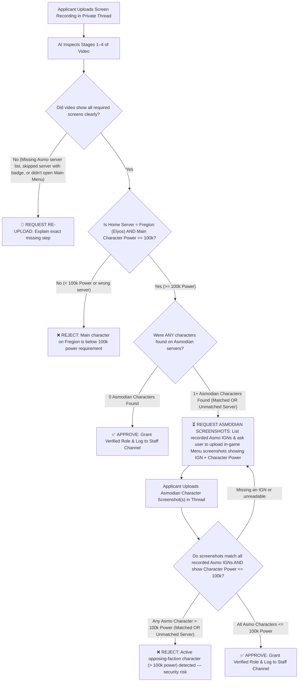

# AI Video & Screenshot Verification Reviewer — Feature Specification

> [!IMPORTANT]
> **Status:** Documentation & Design Specification Only (No code changes implemented yet).
> **Target Game:** Aion 2
> **Default Deployment Context:** Home Faction = **Elyos** | Home Server = **Fregion** *(100% configurable in WebUI for future server merges or other Discord servers).*

---

## 1. Overview & Purpose

The **AI Video Reviewer Agent** automates and assists with verifying screen recordings (and follow-up character screenshots) submitted by applicants inside their private Discord verification threads (`Case #xxxx`).

Its primary goal is **Faction Security (Anti-Spy / Anti-Snitch Protection)**:
1. Confirm the applicant genuinely plays an active main character on the **Home Faction & Home Server** (e.g., **Elyos — Fregion**) with at least **100,000 Character Power**.
2. Audit the applicant's **Opposing Faction Server List** (e.g., **Asmodian**) to detect any characters created on rival servers.
3. If opposing-faction characters exist (whether on the **currently matched rival server** or an **unmatched opposing server**), require proof of those characters' **IGN** and **Character Power** and **reject** verification if any opposing-faction character exceeds **100,000 Character Power**.

---

## 2. Reference Video Breakdown (`SampleVideo.mp4`)

Based on frame-by-frame inspection of `SampleVideo.mp4` (`00:00 – 01:00`), a valid submission follows a **4-stage continuous recording sequence**:

| Stage | Timestamp in Sample | Screen Shown | What the AI Reviewer Extracts & Verifies |
| :--- | :--- | :--- | :--- |
| **Stage 1: Opposing Faction Server List** | `00:04 – 00:11` | **Select Faction → Asmodians → Server List** | • Verifies the emblem on the right says **Asmodians**. • Scans all 10 servers (`Nadala`, `Israphel`, `Zikel`, `Triniel`, `Lumiel`, `Marchutan`, `Azphel`, `Ereshkigal`, `Beritra`, `Kemon`). • Detects any server with a **yellow character-count badge** (e.g., `Nadala [2]`). |
| **Stage 2: Opposing Faction Character Lobby** | `00:11 – 00:25` | **Asmodian Server Character Select (`Nadala`)** | • Confirms the player enters **every** Asmodian server that had a character badge. • Records the **IGN**, **Level**, **Location**, and **Last Login** of every character slot shown (e.g., Slot 1: `쐥띡` `Lv. 1` `34d ago`; Slot 2: `Fio` `Lv. 29` `26d ago`). |
| **Stage 3: Home Faction & Server Lobby** | `00:27 – 00:48` | **Select Faction → Elyos → `Fregion [4]` → Character Select** | • Confirms transition back to **Elyos** and selection of **Fregion**. • Records the selected Main Character's **IGN** (`Fiio`) and **Level** (`Lv. 45`) before clicking **Start Game**. |
| **Stage 4: In-Game Main Menu Proof** | `00:57 – 01:00` | **In-Game World + Right-Side Main Menu Panel** | • Reads the top-right character card:   - **Server Name:** `Fregion`   - **Level:** `Lv. 45(14)`   - **Main IGN:** `Fiio` *(must match Stage 3 lobby selection)*   - **Character Power (`⚔️`):** Must be **`>= 100,000`**. |

---

## 3. End-to-End Decision Flow & Conditions

### Detailed Rule Matrix

| # | Condition / Scenario | AI Action | Reason / Security Rationale |
| :--- | :--- | :--- | :--- |
| **1** | **Main Character Power `< 100,000`** on Home Server (`Elyos / Fregion`) | **Reject** (`❌`) | Applicant does not meet the minimum 100k Character Power requirement on Fregion. |
| **2** | **No Opposing Faction (`Asmodian`) Characters Exist** (`0` badges on all Asmodian servers) AND Main Character on `Fregion` is `>= 100,000` Power | **Approve** (`✅`) | Clean single-faction Elyos/Fregion player meeting the power requirement. |
| **3** | **Opposing Faction (`Asmodian`) Characters Detected on Server List**, but player did **not** click into that server to reveal the character IGNs | **Request Re-upload** (`🔄`) | Player must open every Asmodian server that has a character count badge so the AI can record all Asmodian IGNs. |
| **4** | **Opposing Faction (`Asmodian`) Characters Shown in Video** (on *either* the **Matched Rival Server** or an **Unmatched Asmodian Server**) | **Hold & Request Screenshots** (`⏳`) | AI notes the exact Server Name(s) and IGN(s) of every Asmodian character shown in the video and replies in the thread asking the user to upload in-game menu screenshots of each listed IGN showing its **Character Power**. |
| **5** | **Follow-up Screenshot Shows Asmodian Character on Currently Matched Server with `> 100,000` Power** | **Reject** (`❌`) | Player actively plays on the opposing server currently matched against Fregion and poses an immediate intelligence/strategy leak risk. |
| **6** | **Follow-up Screenshot Shows Asmodian Character on Currently Unmatched Server with `> 100,000` Power** | **Reject** (`❌`) | Even if not currently matched with Fregion, future server matchmaking rotations or merges could pair Fregion against this server. |
| **7** | **Follow-up Screenshot(s) Account for All Recorded Asmodian IGNs and All Are `<= 100,000` Power** | **Approve** (`✅`) | Opposing-faction characters are confirmed inactive/low-power alts below the 100k threshold. |

---

## 4. Multi-Server & Future-Proof WebUI Configuration

Because **Fregion** may be merged or renamed in future game updates—and so this exact bot can be deployed on any other Aion 2 server or faction—none of the faction names, server names, or power thresholds will be hardcoded.

### Proposed WebUI Settings Card (in **Video Verify** Tab)

| Setting Field | Type | Default Value (Current Server) | Purpose |
| :--- | :--- | :--- | :--- |
| **AI Reviewer Mode** | Dropdown | `Hybrid (AI Pre-Screen + Staff Escalation)` | Choose between `Off`, `AI Assist (Summary Only)`, `Hybrid`, or `Full Auto`. |
| **Home Faction** | Select (`Elyos` / `Asmodian`) | `Elyos` | Automatically sets the **Opposing Faction** to `Asmodian` (or vice versa if deployed on an Asmodian Discord). |
| **Home Server Name(s)** | Text / Tag Input | `Fregion` | Supports one or multiple server names (e.g., if `Fregion` merges with `Siel` or changes name, you just update this field in the WebUI). |
| **Matched Opposing Server(s)** | Text / Tag Input | *(Configurable per matchmaking rotation)* | Lets admins specify which opposing server(s) are currently matched against the Home Server for explicit tagging in staff logs. |
| **Min Home Character Power** | Number Input | `100,000` | Minimum Character Power required on the Home Server main character. |
| **Max Opposing Character Power (Matched Server)** | Number Input | `100,000` | Maximum allowed Character Power on a matched rival server before automatic rejection *(can also be set to `0` if you ever want zero-tolerance on the matched server)*. |
| **Max Opposing Character Power (Unmatched Server)** | Number Input | `100,000` | Maximum allowed Character Power on any unmatched opposing-faction server before rejection. |

---

## 5. Additional Security Safeguards

> [!TIP]
> **Safeguard A — "Available" Filter Checkbox Check (`00:07`)**
> On the Aion 2 Server List screen (`00:07`), there is an **`[ ] Available`** checkbox in the top-right corner. If a user checks `Available`, full/restricted servers (`Zikel`, `Triniel`, `Ereshkigal`) might be hidden from the list.
> - **Rule:** Require the `Available` checkbox to remain **unchecked** so all 10 opposing-faction servers are visible on screen.

> [!WARNING]
> **Safeguard B — Anti-"Gear Stripping" Protection on Opposing Characters**
> A spy with a `180k` power `Lv. 45` Asmodian character could **unequip their weapon and armor** right before taking the follow-up screenshot so their Character Power temporarily reads `< 100k`.
> - **Rule Option 1:** If an opposing-faction character is **Max Level (`Lv. 45`)** (or `Lv. 40+`), escalate the case to **Human Staff Review** even if the screenshot shows `< 100k` power, OR require the screenshot to show their **Stats / Equipment window** alongside the menu.
> - **Rule Option 2:** Also check the **`Last Login` timestamp** visible on the character lobby (`00:18` shows `34d ago` and `26d ago`). If an opposing-faction character shows a very recent login (e.g., `hours ago` or `1d ago`) at high level, flag it on the Staff Review embed.

> [!NOTE]
> **Safeguard C — Configurable Minimum Level Threshold for Opposing Screenshots**
> In `SampleVideo.mp4` (`00:17`), the first Asmodian character on `Nadala` is **`Lv. 1` (Last login: `34d ago`)**.
> - **Rule:** Provide a configurable WebUI setting: `Require screenshots for opposing characters at or above Level: [ 1 ]` (default `1` to require all characters, or adjustable to `20` to fast-track level 1 placeholders).

> [!NOTE]
> **Safeguard D — Home Server Lobby-to-Menu Continuity Check**
> Between `00:48` (clicking `Start Game` on `Fiio`) and `00:57` (loading into the world), there is a 9-second dark loading screen (`00:51–00:56`). To prevent a user from splicing someone else's clip during the loading screen:
> - **Rule:** The AI must verify that the **Main Character IGN and Level** clicked in the Stage 3 Character Lobby (`Fiio`, `Lv. 45`) **identically matches** the IGN and Level shown in the Stage 4 In-Game Menu (`Fiio`, `Lv. 45` on `Fregion`).

> [!NOTE]
> **Safeguard E — Cross-Check Against Discord Nickname (IGN Setup)**
> Since members set their IGN in **Tab 2 (IGN Setup)** before reaching **Tab 3 (Video Verify)**:
> - **Rule:** The AI compares the in-game Main Character IGN (`Fiio`) against the applicant's Discord server nickname (`member.displayName`). If they don't match, the AI can either flag it for staff or automatically update their Discord nickname to match their verified Fregion main character.
